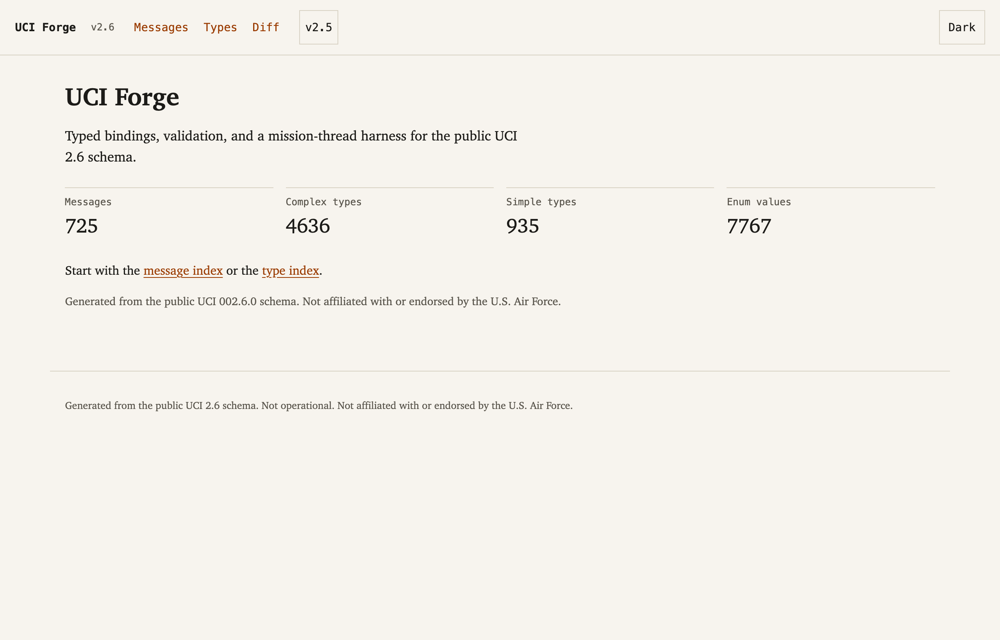
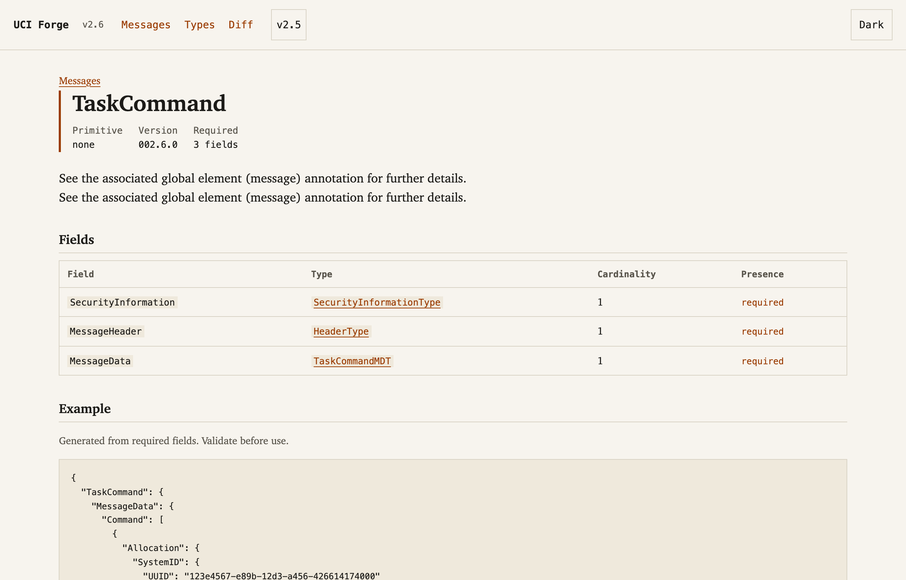
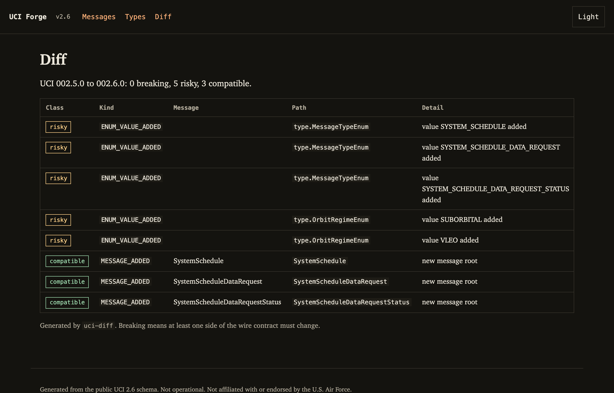
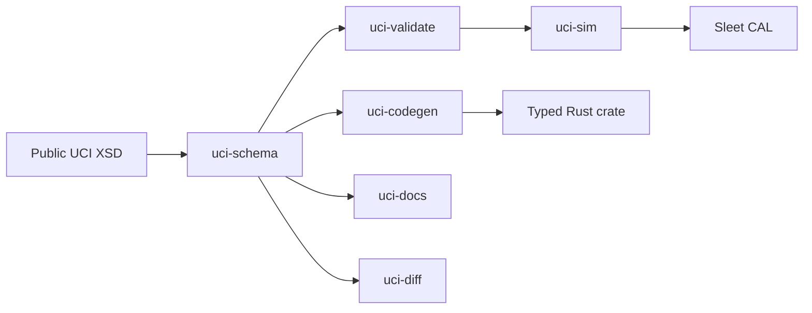

<div align="center">

# UCI Forge

**Unofficial typed tooling for the public UCI 2.6 command-and-control schema.**

A Rust toolchain that turns a 9 MB XSD into typed bindings, validation, a version
diff, a searchable reference, and a scripted mission thread against the reference CAL.

[](https://github.com/vindeckyy/uci-forge/actions/workflows/ci.yml)
[](https://github.com/vindeckyy/uci-forge/actions/workflows/pages.yml)
[](LICENSE)
[](rust-toolchain.toml)
[](https://github.com/open-arsenal/uci)
[](https://github.com/vindeckyy/uci-forge/releases)

[Live docs](https://vindeckyy.github.io/uci-forge/) ·
[Design](docs/DESIGN.md) ·
[Codegen](docs/CODEGEN.md) ·
[Claims](docs/CLAIMS.md) ·
[Examples](examples/README.md) ·
[Verification](docs/EVIDENCE.md)

</div>

> **Status:** unofficial developer tooling. Not certified, not operational, not
> affiliated with the U.S. Air Force. See [claims and limits](docs/CLAIMS.md).



## Why I built this

The Air Force released UCI 2.6 as a 9 MB XSD, six Word documents, and three Java
JARs. It defines 725 message roots, 4,636 complex types, and 7,767 enumeration
values. A new service had no typed bindings, no JSON example corpus, and no small
on-ramp.

I built the on-ramp I wanted: parse the public schema, generate types that survive
standard changes, validate wire messages with useful errors, show what changed
between versions, and prove a task and report flow against Sleet, the Rust
reference CAL.

## What it does

| Capability | Detail |
|---|---|
| Parse | XSD to a stable model, including extension chains, choices, abstract types, and docs |
| Generate | 4,535 Rust structs and 710 enums, generated on demand from 20 core roots |
| Validate | Stable error codes and exact JSON paths |
| Diff | UCI 2.5 to 2.6: 0 breaking, 5 risky, 3 compatible |
| Document | 10,702 pages for 2.6 and 2.5, search, examples, version switch |
| Integrate | Scripted task and signal flow against Sleet over OWP |
| Fuzz | Parser target, 10,000 runs, no crash |

## Verification

| Gate | Result |
|---|---|
| Tests | 151 pass |
| Coverage | 98.18% lines, 97.37% regions, 96.75% functions |
| Changed-line gate | 95% minimum, 100% on the current change |
| CI | Green on Ubuntu, macOS, and Windows |
| Release | v0.1.0 with Linux, macOS, and Windows binaries |
| Generated crate | 2 round-trip tests, 100 iterations each |
| Docs | 10,702 pages, static checks and 30 browser checks pass |
| Accessibility | 8 contrast pairs pass WCAG AA, keyboard focus, light and dark themes |
| Diff | 0 breaking, 5 risky, 3 compatible |
| Fuzzing | 10,000 parser runs, no crash |
| Sleet | One scripted scenario, 4 events, not a certification |

Generated output is not committed. CI generates the crate, compiles it, and runs
its round-trip tests.

Reproduce everything with `make check`. Command output and evidence are in
[docs/EVIDENCE.md](docs/EVIDENCE.md). The antislop report is in
[docs/DELIVERY-GATE.md](docs/DELIVERY-GATE.md).

## Quick start

```bash
git clone https://github.com/vindeckyy/uci-forge.git
cd uci-forge
```

Prebuilt binaries: [v0.1.0](https://github.com/vindeckyy/uci-forge/releases/tag/v0.1.0).

```bash
make fetch-spec
cargo run -p uci-cli -- schema-stats
cargo run -p uci-cli -- docs --out site --diff-old spec/002.5.0
cargo run -p uci-cli -- sim examples/scenarios/tasking.toml --embedded
```

More runnable examples: [examples/README.md](examples/README.md). The smoke script
checks schema counts, validation, and a four-event scenario:

```bash
./examples/smoke.sh
```

Generate the typed crate:

```bash
cargo run -p uci-cli -- gen --out examples/generated/uci-types
cargo test --manifest-path examples/generated/uci-types/Cargo.toml
```

Run against the reference CAL:

```bash
sleet fixtures/sleet/server.toml
cargo run -p uci-cli -- sim examples/scenarios/tasking.toml \
  --broker ws://127.0.0.1:9100/ --transcript transcripts/tasking.jsonl
```

## Screenshots

| Message reference | Version diff, dark theme |
|---|---|
|  |  |

## Design decisions

Generated enums keep unknown values in `Unknown(String)`. A newly added standard
value does not fail deserialization.

Optional fields are omitted when absent, so a round trip does not add empty keys to
the wire message.

Recursive types box only graph back edges. The generated crate stays finite without
boxing every field.

Abstract types use `serde_json::Value` with a `$type` string. Full polymorphism is
deferred, and the limit is documented in the README and the codegen tests.

The validator is the single source of truth for structural rules. Codegen and docs
consume the same parsed schema.

## Generated types

```rust
pub struct TaskCommand {
    #[serde(rename = "SecurityInformation")]
    pub security_information: SecurityInformationType,
    #[serde(rename = "MessageHeader")]
    pub message_header: HeaderType,
    #[serde(rename = "MessageData")]
    pub message_data: TaskCommandData,
}
```

## Architecture



| Crate | Purpose |
|---|---|
| `uci-schema` | XSD parser and model |
| `uci-codegen` | Rust type generation |
| `uci-validate` | JSON validation |
| `uci-diff` | Version diff and compatibility classes |
| `uci-docs` | Static reference site |
| `uci-sim` | OWP client, scenario runner, in-process broker |
| `uci-cli` | `forge` binary |

## What this demonstrates

| Area | Evidence |
|---|---|
| Standards work | UCI 2.6 schema, OMS/OWP message flow, Sleet integration |
| Compiler and codegen | XSD model to 4,535 structs and 710 enums |
| Protocol integration | OWP client, subscriptions, task and report flow |
| Verification | 151 tests, 98.18% line coverage, 10,000 fuzz runs |
| Technical writing | 10,702 reference pages, search, version switch |
| Security discipline | Public Distribution A only, no CUI, no compliance claims |

## Scope and limits

This is public-schema tooling, not operational software. It does not claim
compliance, certification, or approval. It uses Distribution A data only. Do not
put it on a weapon system.

The generated crate covers 20 curated roots, which pull in 4,535 reachable types.
The optional browser playground was cut. The full 725-message surface is documented
but not generated.

## About

I build systems software in Rust. I built UCI Forge to learn the UCI and OMS
ecosystem from the schema up. I am open to mission-systems, C2, and defense software
roles. Reach me through GitHub.

If you work on UCI, OMS, or A-GRA and see a gap, open an issue.

## License

Apache-2.0. See [LICENSE](LICENSE) and [NOTICE](NOTICE). The UCI schema remains a
U.S. Government work released under Distribution Statement A.

Not affiliated with or endorsed by the U.S. Air Force or the Department of War.
